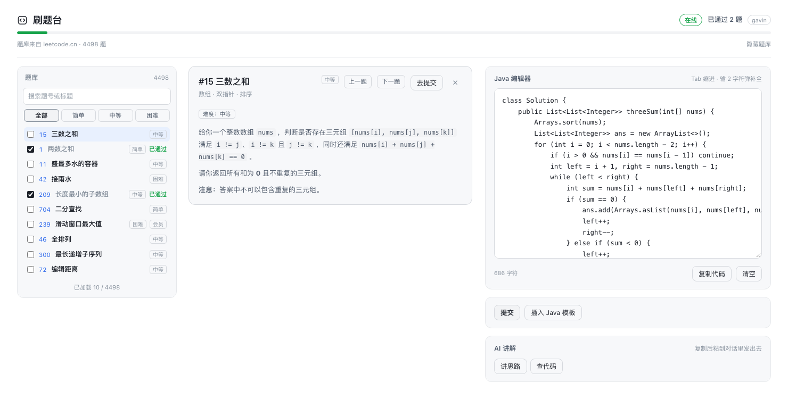

# dsh-leetcode-bench



在 DSH 左侧栏开一整页刷 Java 题：题库实时从 leetcode.cn 拉取，每题独立的草稿、本地补全、一键提交看判题结果；卡住时把题目和代码一键复制到对话，让智能体讲（那边有 openui、图表和工具）。

```
左侧栏「刷题台」→ 主区整页
  ├ 左：题库（搜索 / 难度筛选 / 分页，可整列收起）
  ├ 中：中文题面 + 难度 + 去提交
  └ 右：Java 编辑器（补全 / 自动缩进）+ 提交 + AI 讲解
```

## 安装

```bash
# 从 GitHub
dsh plugin --profile web add github:gavin-ali/dsh-leetcode

# npm（发布后）
dsh plugin --profile web add dsh-leetcode-bench
```

桌面端：**设置 → 插件 → 从 GitHub 安装**，填 `gavin-ali/dsh-leetcode`。

装完重启一次 DSH，左侧栏出现「刷题台」图标。不需要另起任何进程。

## 功能

- **题库**：实时调 `leetcode.cn` 的 `problemsetQuestionList`，支持关键词搜索、难度筛选、分页加载；显示题号、中文标题、难度、会员题标记、已通过状态。**插件不内置任何题库数据**。
- **进度**：每题草稿、勾选、筛选条件都存本机 `localStorage`，不跟随会话；换题是干净的编辑器，换回来恢复上次写的。
- **编辑器**：308 条本地补全字典（`Lis` → `List<Integer>`，`HashM` → `new HashMap<>()`，`s.sub` → `substring`），`Tab` / `Shift+Tab` 缩进，回车自动缩进（`{` 开级、`}` 自动顶到外层）。可以从题目详情一键「插入 Java 模板」（取自 LeetCode 的官方代码片段）。
- **题面**：从 leetcode.cn 拉中文题面，净化后页内渲染（去 script / 事件属性 / `javascript:` 链接）。
- **提交**：一键提交整段 Java，页内显示通过 / 解答错误 / 编译错误 + 用例数 + 耗时。
- **AI 讲解**：两个按钮（讲思路 / 查代码），把「题目 + 题面摘要 + 你的代码 + 要求」拼成一条消息复制到剪贴板；粘进对话由真正的智能体回答，并按要求用 openui 画过程演示。页面自身不跑模型。

## 登录与隐私

提交需要你在页面里粘一次 `LEETCODE_SESSION` 和 `csrftoken`（浏览器登录 leetcode.cn 后 F12 → Application → Cookies 里复制）。

- 凭据只写到本机 `~/.dsh/dsh-leetcode-bench/cookie.json`（权限 `600`），由 DSH 主进程在请求时使用；页面自己不发网络请求，也不把凭据写进 `localStorage`。
- 唯一的外部请求发往 `leetcode.cn`。插件不含遥测、不上传任何数据、不读工作区文件（除了上面那个 cookie 文件）。
- 退出：删掉 `~/.dsh/dsh-leetcode-bench/cookie.json` 即可。仓库里不包含、也不需要任何账号凭据。

## 兼容性

对着 DSH `0.2.2-rc.1` 写的：用 `main` + `sidebar.panellist` 两个 slot，以及 `connection.fetch.register` 注册 `/api/dsh-leetcode-bench/*` 同源路由。这些是 DSH 内部接口，升级大版本后可能失效（页面不出现或路由 404），需要跟着改。

## 开发

```bash
npm run build      # 把 src/data.mjs 的补全字典内联进 lib/client.js 并校验清单
npm test           # jsdom 冒烟 + 回车缩进单测
```

`npm test` 需要能 require 到 `react`、`react-dom`、`jsdom`，可用 `REACT_DIR=/path/to/node_modules npm test` 指定。

## License

MIT
